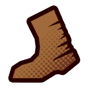
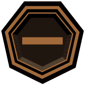
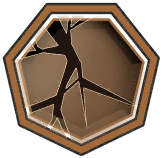
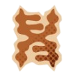
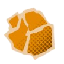

# Regras Gerais do Combate

Conforme explicado na introdução, o sistema Moon possui um grande foco em adaptar as diversas mecânicas do combate dinâmico de Limbus Company, onde, em outras palavras o sistema Moon possui um combate em que todas as suas escolhas possuem consequências diretas ou indiretas. 

<h3>Speed</h3>
Em todo início de uma cena todos os participantes do combate devem rolar a sua Speed, para definir quando irão agir, essa rolagem no caso dos jogadores é definida por meio da classe, também podendo ser aumentada com efeitos ou perks.

<h3>Ações</h3>
No sistema Moon só existem dois tipos de ações: Ativas e Reativas. Por padrão todas as criaturas possuem um total de duas ações por turno, que podem ser utilizadas para usar ações de qualquer tipo sem restrições.

<h3>Stagger</h3>
A maioria das criaturas possuem uma ou mais marcações na sua vida, essas marcações são conhecidas como Marcas de Stagger. Quando uma criatura sofre dano além dessa marcação ele fica em Stagger pelo turno que isso aconteceu e o próximo. Uma criatura em Stagger tem todas as suas resistência alteradas para Vulnerável (2.0x) e não pode agir. Mas jogadores que entrarem em Stagger poderão ainda agir, só que: Todas as suas rolagens são feitas com desvantagem, seu movimento é reduzido pela metade e as suas ações são reduzidas pela metade (arredondado para cima).

<h3>Sanidade (SP)</h3>
Uma das principais mecânicas utilizadas no combate, a sanidade é responsável por determinar a probabilidade de rolar cara ou coroa em moedas das Skills do Kit de personagens, também sendo um recurso consumido para ativar E.G.O. Seu valor máximo sendo 45 e seu valor minímo sendo -45, seguindo a fórmula:

~H = 50 + (SP)~

Em outras palavras isso indica que um personagem tem uma probabilidade miníma de 5% de rolar cara e uma máxima de 95% de rolar cara. 

Quando um combate começa todos os Jogadores por padrão começam com 0 de SP, salvo exceções ditadas pelo mestre, onde também o seu ganho e redução é delimitado pela aba de Sanidade presente no Kit do personagem, devido ao fato de que as criaturas podem e irão funcionar de formas distintas, como é o próprio caso de Kits com foco em Sanidade negativa e não positiva.

Jogadores que também possuem a forma de E.G.O com corrosão precisam realizar um teste de prudência com DC variável caso atinjam a marca de -45 de Sanidade, em caso de falha nesse teste o mesmo ganha @(E.G.O Corrosion) no fim dessa mesma cena.

<h3>Moon Points (MP)</h3>
Assim como a sanidade os Moon Points ou de forma simplificada MP, é um recurso utilizado por todas as criaturas para usar Skills do seu Kit devido ao fato de que por padrão elas possuem custos únicos para serem utilizadas. 

Por padrão a quantidade de MP de todas as criaturas começa em 3, mas tal valor é aumentado com base em diversos fatores, no caso de Players se trata exclusivamente do seu nível ou item extremamente especial.

Quando um combate começa todas as criaturas ganham MP igual ao seu valor máximo, recuperando por padrão 1 MP no fim da cena, valor esse que pode ser aumentado com base em circunstâncias especiais.

<h3>Pecados (Sins)</h3>
Por fim existe uma última mecânica importante referente ao Kit de um personagem, os chamados Pecados ou de forma simplificadas Sins. Normalmente toda arma, skill ou E.G.O possui uma afinidade com um dos 7 Sins, onde mecânicamente falando Sins são recursos que são ganhos quando uma arma, skill ou E.G.O são utilizados, e taís recursos são consumidos por E.G.O junto do SP para permitir a sua ativação.

E como discutido acima, cada um dos sins discutidos possui uma cor e icone que o representa (mostrados abaixo) com exceção dos casos que realmente a arma, skill ou E.G.O não possua afinidade com nenhum pecado, a qual é denominada Sinless.

 

<h4>Wrath (Ira)</h4>

<h4>Lust (Desejo)</h4>

<h4>Sloth (Preguiça)</h4>

<h4>Gluttony (Gula)</h4>

<h4>Gloom (Tristeza)</h4>

<h4>Pride (Orgulho)</h4>

<h4>Envy (Inveja)</h4>

