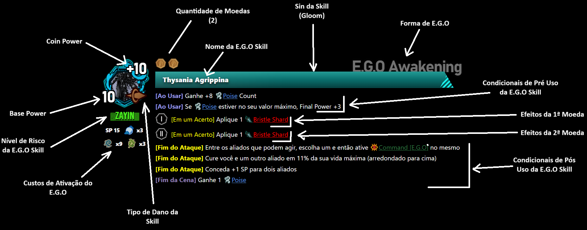
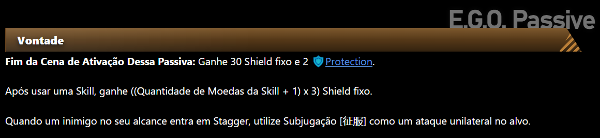

# E.G.O

Uma habilidade única que é restrita a um pequeno grupo de pessoas na Cidade, sua maestria é algo extremamente complicado devido a alta força que tal habilidade é capaz de mostrar, por isso E.G.O acabam sendo dividos nas seguintes classificações:

 

 

Zayin se trata do nível mais baixo e menos volátil indo em ordem crescente até Aleph o nível mais perigoso, tanto para o alvo como para o próprio usuário.

Uma E.G.O Skill pode possuir duas formas de uso distintas: Awakening e Corrosion, onde de forma simplificada a primeira se trata de uma forma de uso estável do E.G.O e a segunda da forma mais perigosa em que o alto risco trás resultados bem mais significativos. 

Por padrão uma E.G.O Skill só pode ser utilizada uma vez por cena desde que o usuário pague os custos de sua ativação, ainda que haja essa limitação E.G.O Skills podem ser ativadas por diversos outros meios como com o uso de @(Command [E.G.O]).

 

 

No fim do da cena da primeira ativação de uma E.G.O Skill o usuário ganha @(E.G.O Passive).

 

