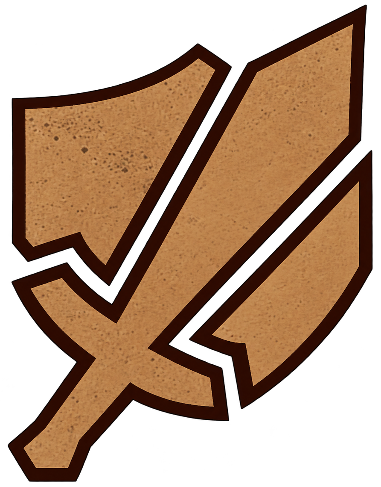
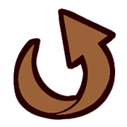
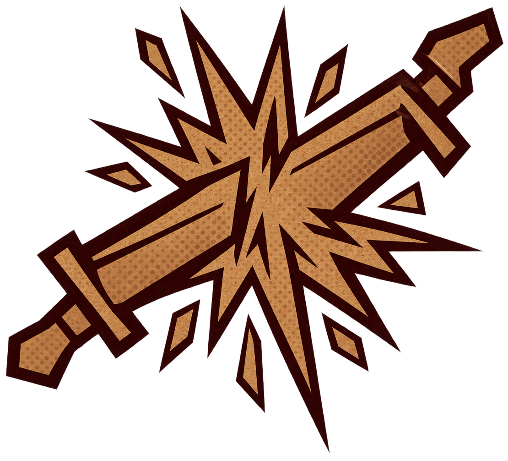

# Reações de Combate
No sistema Moon além das ações Ativas também existem as ações Reativas, mais conhecidas como Reações que são consideradas Defense Skills. 

Por padrão cada personagem possui uma reação única definida em seu Kit, mas existem casos em que uma criatura possa possuir mais de uma, com exceção da reação de Clash que é genêrica e utilizável por todos os personagens.

Note que:
- A condição "ao sofrer um ataque" só é ativada quando você realmente for sofrer o ataque e não na tentativa.
- Defense Skills não podem ser utilizadas para Clash, a não ser que na descrição da Defense Skill esteja escrito.

 

### Guard
Ao sofrer um ataque, ganhe Shield Fixo igual a Guard. No cálculo de ganho de Shield fixo o Base Power também é considerado.

 

### Counter
Ao sofrer um ataque, contra ataque seu atacante com Counter, desde que você tenha alcance. No cálculo de dano o Base Power também é considerado.

 

### Evade
Ao sofrer um ataque, você pode usar Evade para tentar se esquivar, se o resultado exceder ou for igual a rolagem do inimigo você esquiva com sucesso, ignorando o dano e condicionais de "Em um acerto".

 

### Clash
Quando um ataque corpo a corpo é feito, você pode usar uma Attack Skill ou E.G.O Skill para contestar esse ataque desde que possua alcance. Durante um Clash com Skills ambos irão rolar suas Skills, onde, quem perder a comparação perde uma das suas moedas da Skill em ordem crescente, e esse processo se repete até que um dos dois perca completamente as suas moedas da Skill, consequentemente o ganhador ataca o outro. Para motivos de ativação de efeitos, cada comparação de Clash é considerada uma ação.

 