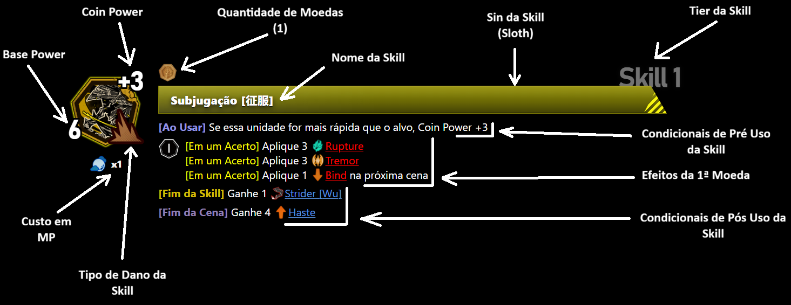
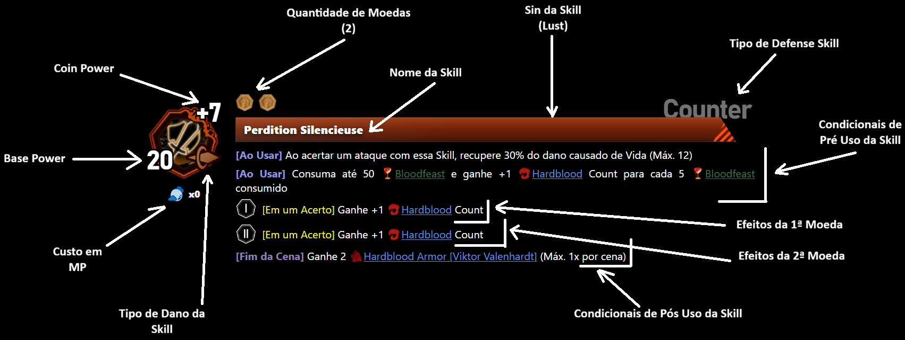

# Skills

De forma simplificada uma Skill se resume a uma habilidade com um valor base e diversas moedas que ativam e aplicam efeitos únicos, também com base no seu resultado fortificam o resultado de acerto e o próprio dano final da Skill. Mas apesar da definição genérica, Skills podem ser divididas em três variações: Attack Skills, Defense Skills e E.G.O Skills, que serão discutidas em sua própria aba.

Mas como uma Skill realmente funciona?

1. Checamos o valor base dela, referenciado como "Base Power", iremos supor uma Skill com base Power 10.
2. Então olhamos o valor das moedas dela e a quantidade, supondo uma Skill com 3 moedas e com "Coin Power" +3.
3. Fazemos as rolagens necessárias, ou seja, 10 + (Coin Power), uma moeda tem uma chance de até 95% de rolar Cara, que nesse caso concede ao acerto da Skill o bônus da moeda (isso se repetindo para cada moeda), caso a moeda resulte em coroa esse bônus é simplesmente ignorado.
4. Então supondo que nossa Skill só rodou 2 moedas cara, o resultado do acerto ficaria: 10 + (3 + 3) = 16
5. Agora considerando que acertamos essa Skill, agora iremos rolar o seu dano, vamos utilizar 1d12 (6) + Fortitude (5) por exemplo, com isso rolaremos novamente as moedas para ver se elas caem em cara ou coroa, nesse exemplo iremos utilizar o caso de só uma ter resultado em cara, o dano final desse ataque seria: (Dano Base + Bônus das Moedas) = ((6 + 5) + 3) = 14 de dano.
6. Note que Power Up, Attack Power Up, Power Down, Attack Power Down, Clash Power Up e Clash Power Down também são considerados na soma de dano, em outras palavras o Final Power e Coin Power.
7. Por fim levamos em conta o "Atk Weight" que delimita quantas criaturas receberão o ataque dentro do alcance.

 

# Attack Skills
Attack Skills se tratam de habilidades ofensivas que comumente são o foco quando a reação de Clash é utilizada, cada uma delas é dividida em um total de três Tiers: S1, S2 e S3. Cada um desses tiers referência o custo em MP para sua ativação.

No caso de Skills com moedas negativas, a regra do cálculo de dano é alterada para adicionar o Base Power nos cálculos ao invés do Coin Power.

 
 

# Defense Skills
Defense Skills se tratam de habilidades defensivas que por muitas vezes são utilizadas como opções viáveis para lidar com o gerenciamento de MP.

