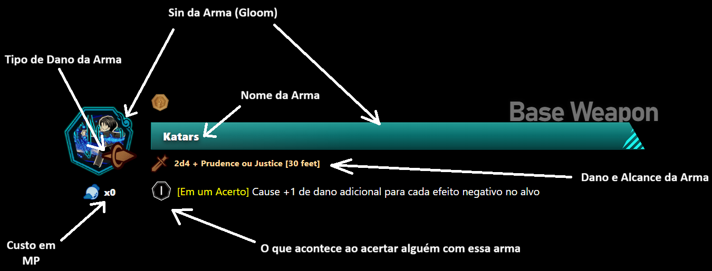

# Armas

Todas as Skills de ataque utilizam como base uma arma genérica, referida como "Base Weapon", que serve como referência para o dano base e alcance de Skills, mas ainda podendo ser utilizada separadamente para atacar.

Note que: 
- Os efeitos do ataque de uma arma base não são repassados a todas as Skills, eles somente são ativados ao atacar com a arma base. 
- O acerto de uma arma base é definido como: d10 + Atributo Preferido.
- Armas que possuirem Base Power e Coin Power não podem ser utilizadas como base para Skills, devido ao fato dessas armas já serem tratadas como Skills.

 

